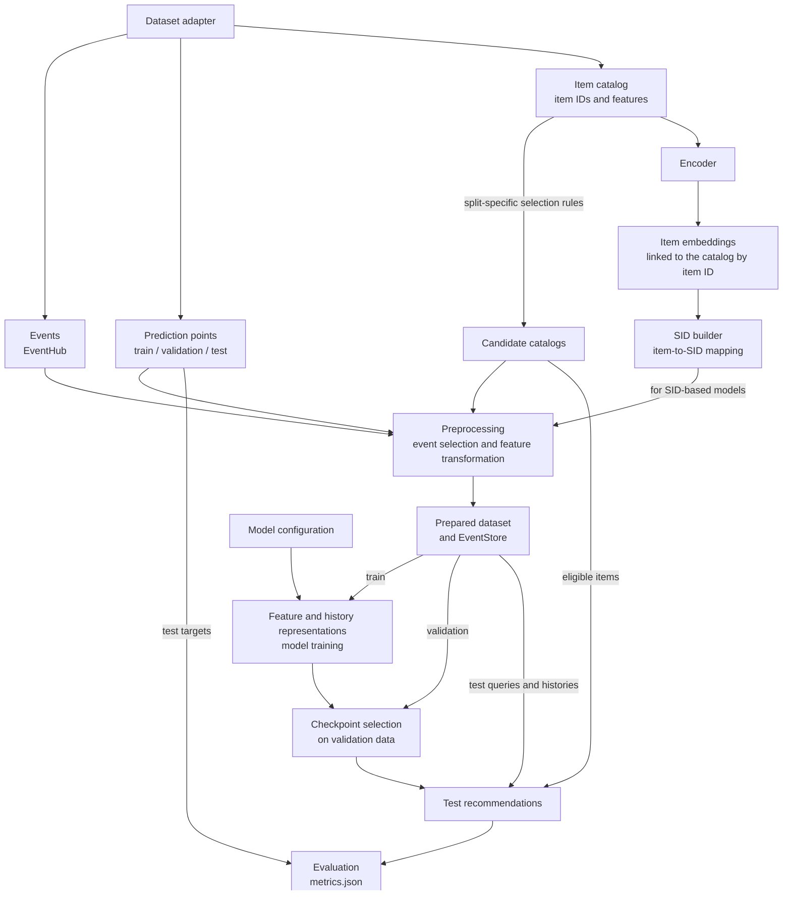

# GenRec-Perseus

An event-centric toolkit for reproducible generative recommendation.
It brings data preparation, Semantic-ID construction, model training, and
recommendation evaluation into a shared workflow over user event histories.

## Contents

- [Overview](#overview)
- [Key concepts](#key-concepts)
- [Workflow](#workflow)
- [Models](#models)
- [Installation](#installation)
- [Event Hub](#event-hub)
- [Quickstart](#quickstart)
- [Reproducing the paper experiments](#reproducing-the-paper-experiments)
- [License](#license)

## Overview

- **Heterogeneous event histories:** multiple action types and domains, item
  features, user context, and configurable history windows.
- **Recommendation models:** OneRec, our native GRID (TIGER) implementation,
  and HSTU as a sequential baseline.
- **Interchangeable SID builders:** residual K-Means (RK-Means), residual vector
  quantization (RVQ), and RQ-VAE. Fitted item-to-SID mappings can be reused across
  models and runs.
- **Comparable experiments:** shared prepared data for compatible configurations,
  separate train/validation/test splits, and evaluation over specified candidate
  catalogs.
- **Scalable execution:** reusable prepared data, distributed training, and
  distributed inference for supported models.

## Key concepts

| Concept | Description |
|---|---|
| **Event** | A user identifier, timestamp, event type, and attributes. The type distinguishes actions such as purchases and views and defines their attribute schema. |
| **EventHub** | Raw events stored in Parquet, partitioned by event type, date, and user hash. The directory name identifies the event type. |
| **Basis table** | Prediction points: each row contains a user, prediction time, optional context, and positive target items. The dataset adapter prepares separate train, validation, and test splits. |
| **History stream** | A sequence of events preceding a prediction point. The configuration specifies event types, features, a time window, and an event-count limit. A prediction point can have multiple history streams. |
| **Item catalog** | Item identifiers and features prepared by the adapter. It covers items needed for histories, targets, and recommendations. |
| **Candidate catalog** | Items eligible for recommendation in a given split. The protocol defines it independently of the targets; it may differ from the set of items in histories. |
| **Item embeddings** | An encoder maps item features to numerical vectors linked to the catalog by item ID. The encoder can be external. These vectors are used to construct SIDs for items in histories, targets, and candidate catalogs; the protocol determines which items may be used to fit the SID builder. |
| **Semantic ID (SID)** | A sequence of discrete item codes. A separately fitted SID builder produces a fixed item-to-SID mapping for a recommendation model run. |
| **EventStore** | Persisted, preprocessed events: categorical codes, SIDs, and other transformed features. Models use them to construct histories for training and inference. |
| **Checkpoint** | Saved configuration, preprocessing state, and, after training, model weights. |

## Workflow



The adapter defines the prediction task: which items to predict, for whom, and
at what time. Histories contain preceding events; the current targets and future
events are excluded from the query history. Candidate catalogs are specified
independently of the targets.

For SID-based models, the item-to-SID mapping is constructed from item embeddings
before model training. Shared data preparation validates the inputs, fits
preprocessing on the training split or uses fixed resources, and saves the
transformed events and samples. Compatible model configurations can reuse these
prepared data.

Models are trained on training samples. Validation data is used for checkpoint
selection, and the test split is reserved for final evaluation.

## Models

| Model | Implementation in this toolkit |
|---|---|
| **OneRec** | A dense T5 encoder–decoder with configurable history streams and user context, plus optional QFormer history compression. Generates item SIDs. |
| **GRID (TIGER)** | Our native implementation with one configurable history of item SIDs. Generates item SIDs. |
| **HSTU** | A sequential baseline that scores candidate items directly. |

## Installation

Requires Python 3.12–3.13 and Poetry. Run commands from the repository root:

```bash
poetry install
source .venv/bin/activate
```

## Event Hub

Events are the main source of information about a user. The toolkit includes a
local, user-partitioned Parquet store called **EventHub**, compatible with the
[Perseus](https://github.com/perseus2026/perseus) storage format. No external
service is required.

### Configuring storage

An EventHub source is a directory containing events. Point the default
`event_hub` source to a local directory:

```bash
export INTERNAL_STORAGE_EVENT_HUB=work/eventhub
```

You can import different event types from multiple sources and use them together
in a model. Shared user identifiers connect histories across sources and domains.

### Managing events

Events are added as Parquet tables. Each table must contain `client_id` (`String`)
and `timestamp` (`Datetime(ns)`, UTC without timezone information), with no nulls
in either column. Other columns become event attributes, such as `item_id` or
`amount`.

```bash
# Add events of a given type from a Parquet file.
python -m genrecsys event-hub add-events events.pq --name view

# List available event types, date ranges, and attributes.
python -m genrecsys event-hub list-events

# Delete events, optionally within an inclusive date range.
python -m genrecsys event-hub delete-events --name view \
  --date-from 2026-01-01 --date-to 2026-01-31
```

The CLI partitions events by date and user. Reimporting replaces the affected
date/partition files rather than appending rows, so supply the complete event
set for each file being replaced. Omitting both dates from `delete-events`
deletes the entire event type.

### Referencing events in a config

The name passed to `--name` becomes a key in the `events` section:

```yaml
events:
  view:                         # Read from the default event_hub source.
    attributes:
      item: {field: item_id}
```

A model can also read events from multiple EventHub directories. Register each
additional source with `INTERNAL_STORAGE_<SOURCE>`, select it with the event's
`source` field in YAML, and pass `--source <name>` to manage its events through
the CLI. If `source` is omitted, `event_hub` is used.

## Quickstart

This example recommends the next item from a history of views. It starts with
adapter-prepared files and walks through model training and evaluation.
Run the commands from the repository root after installing and activating the
environment.

### 1. Prepare the input files

Your dataset adapter defines the splits and prediction points, writes one or
more event tables (`events.pq` in this example), and prepares the catalogs.
Also provide item embeddings computed by your chosen encoder. Place the model
configuration at `work/quickstart/config.yaml`; use the
[example configuration](examples/quickstart/config.yaml) as a starting point.
Lay out the input files as follows:

```text
work/quickstart/
  config.yaml                    # Features, model inputs, training, and metrics.
  events.pq                      # Views: user, timestamp, item.
  embeddings/
    train/
      items.pq                   # Items used to fit the SID builder.
      embeddings.npy             # Their precomputed embeddings.
    inference/
      items.pq                   # Full item set to assign SIDs to.
      embeddings.npy             # Embeddings for these items.
  basis/
    train/
      samples.pq                 # Prediction points and targets.
      artifacts/items.pq         # Eligible candidate items.
    validation/
      samples.pq
      artifacts/items.pq
    test/
      samples.pq
      artifacts/items.pq
```

| File | Fields and example |
|---|---|
| `events.pq` | `client_id`, `timestamp`, `item_id`: user `u1` viewed item `101` at `2026-01-01 10:00:00 UTC`. |
| `basis/<split>/samples.pq` | `client_id`, `timestamp`, `target`, and optional `sample_id`: query `test-u1` for `u1` at `2026-01-02 10:00:00 UTC`, with positive items `[102]`. |
| `basis/<split>/artifacts/items.pq` | A unique `item_id` column: the split's candidate catalog, not just its targets. |
| `embeddings/train/items.pq` | A unique `item_id` column: items permitted by the protocol for fitting the SID builder. |
| `embeddings/inference/items.pq` | A unique `item_id` column: all items that need SIDs, covering histories, targets, and candidates. |
| `embeddings/<train or inference>/embeddings.npy` | A matrix of shape `[num_items, embedding_dim]` with a floating-point dtype, such as `float32`. |

`sample_id` identifies a prediction point and matches predictions to targets
regardless of row order or inference partitioning. It is not a model feature.
If provided, it must be unique and non-null within each split; otherwise,
the `(client_id, timestamp)` pair must be unique and serves as the query identity.

In each `items.pq` / `embeddings.npy` pair, row `i` of the table corresponds to
row `i` of the matrix. The training item set is a subset of the full catalog
with the same embeddings and dimensionality; the experiment protocol determines
its membership.

The item catalog and SID mapping must cover targets and history items.
Identifiers and their dtypes must match across files. The `target` column holds
lists of item IDs, and timestamps represent UTC. A query's history contains
only events strictly before its prediction time. In the example above, the view
of item `101` is included; an event at the target timestamp is not.

Import the views into EventHub:

```bash
export INTERNAL_STORAGE_EVENT_HUB=work/quickstart/eventhub
python -m genrecsys event-hub add-events work/quickstart/events.pq \
  --name view
```

The resulting storage layout looks like this (dates and partition numbers are
illustrative):

```text
work/quickstart/eventhub/
  view/
    2026-01-01/
      0001.pq                    # Events for one user hash partition.
      0042.pq
    2026-01-02/
      0001.pq
```

You can import events from different `.pq` files into the same EventHub, assigning
each event type with `--name`. Files with matching event type, date, and partition
are replaced. Models can also read from multiple EventHub sources.

You can prepare item embeddings yourself or use the framework's built-in tool
to compute them from text with a SentenceTransformer-compatible model. The
example below uses Qwen3-Embedding-0.6B.

Prepare the inputs under `work/quickstart/`:

- `catalog.pq`: the full item catalog, with unique `item_id` values and a `text`
  column. It must cover history items, targets, and candidates.
- `train-items.pq`: unique `item_id` values for fitting the SID builder, forming
  a subset of `catalog.pq` as defined by your experiment protocol.
- `embeddings/`: the output directory; it must not already exist.

With the environment activated, run:

```bash
# Download the text encoder.
hf download Qwen/Qwen3-Embedding-0.6B \
  --local-dir work/models/qwen3-embedding-0.6b

# Encode the full catalog and copy its training subset.
python -m item_representations.text encode-catalog \
  --catalog work/quickstart/catalog.pq \
  --train-items work/quickstart/train-items.pq \
  --model-path work/models/qwen3-embedding-0.6b \
  --output-dir work/quickstart/embeddings \
  --output-dim 1024
```

Encoding requires a CUDA GPU by default. The command creates the `train/` and
`inference/` file pairs shown above, copying the training vectors from the
full-catalog matrix.

### 2. Build Semantic IDs

Fit residual K-Means on the training item set, then apply it to the full catalog:

```bash
python -m item_representations.semantic_ids fit-sid-mapper --workdir=work/quickstart
python -m item_representations.semantic_ids apply-sid-mapper --workdir=work/quickstart
```

The first command fits the SID builder on `embeddings/train/` and saves it to
`sid-fit/`. The second applies it to `embeddings/inference/` and writes the mapping
to `resources/sid/item_to_sid.parquet` for data preparation.

### 3. Configure the model

Save the configuration to `work/quickstart/config.yaml`. The entry
`artifact: item_to_sid` refers to the mapping from the previous step, which
data preparation reads from `resources/sid/item_to_sid.parquet`.

Key configuration fields (excerpt):

```yaml
events:
  view:
    attributes:
      item: {field: item_id}
encoders:
  item:
    type: semantic_id
    preprocessor: {artifact: item_to_sid, item_id_column: item_id}
    embedder: {prefix_length: 3}
features:
  item:
    located_in: {event: true}
    encoder: item
event_encoders:
  history: {type: concat_projection}
inputs:
  history:
    type: sequence
    events: [view]
    features: [item]
    event_encoder: history
    max_events_per_sequence: 5
```

Here, `view` identifies the event directory, `item_id` is the source feature
column, and `item_to_sid` is the resource name. The configuration specifies
history representations and limits, as well as the model, training, validation,
and evaluation settings.

### 4. Prepare the dataset and train

```bash
python -m genrecsys train prepare-dataset --workdir=work/quickstart

accelerate launch -m genrecsys train fit-model --workdir=work/quickstart
```

The first command saves the prepared samples and EventStore to `dataset/` and
the preprocessing state to `checkpoint/`. The second trains the model using
`config.yaml` and selects a checkpoint by its validation metric. Device settings
are controlled through the Accelerate configuration.

### 5. Generate recommendations and evaluate

```bash
python -m genrecsys inference distribute-samples \
  --workdir=work/quickstart --history-source=event_store
python -m genrecsys inference make-predictions \
  --workdir=work/quickstart --history-source=event_store
python -m genrecsys inference evaluate --workdir=work/quickstart
```

The first command prepares test queries for inference, the second generates
recommendations, and the third evaluates them against the test targets.

| Output under `work/quickstart/` | Contents |
|---|---|
| `checkpoint/model/` | Model weights and `training.json` with training and validation history. |
| `predictions/` | Recommendations for test queries. |
| `metrics.json` | Final metrics specified in the configuration. |

## Reproducing the paper experiments

The full experiments use real datasets and require GPUs. The `run_all.sh`
scripts run data preparation, SID construction, model training, and evaluation
sequentially. A complete run can take considerable time.

| Experiment | Purpose |
|---|---|
| ES1 · Amazon | Reference implementation validation. |
| ES2 · Amazon | Semantic-ID method comparison. |
| ES3 · Yambda | Multi-action and contextual histories. |
| ES4 · T-ECD | Cross-domain histories and scale. |

### ES1 and ES2 · Amazon

For ES1 and ES2, we recommend Python 3.12 for compatibility with the upstream
GRID dependencies.

For automatic Amazon downloads, install the optional dependency group:

```bash
poetry install --only amazon-download
```

Examples for the Beauty category:

```bash
# ES1: OneRec, our native GRID, and the authors' TIGER implementation.
bash scripts/amazon2014-grid/es1/run_all.sh beauty
```

ES1 compares OneRec, our native GRID (TIGER) implementation, and the authors'
TIGER implementation from the [GRID framework](https://github.com/snap-research/GRID).

```bash
# ES2
bash scripts/amazon2014-grid/es2/run_all.sh beauty
```

Replace `beauty` with `toys` or `sports` for the other categories. The scripts
download the source data and required model weights and set up dependencies for
the supporting stages. The main `.venv` must already be installed.

If the automatic dataset download fails, download the
[authors' ZIP archive in a browser](https://drive.google.com/file/d/1B5_q_MT3GYxmHLrMK0-lAqgpbAuikKEz/view)
and extract it by running this command from the repository root:

```bash
bash scripts/amazon2014-grid/download-data.sh "$PWD/work/amazon_data" \
  --archive /path/to/amazon_data.zip
```

Then rerun the ES1 or ES2 command above. Both scripts reuse the extracted data
without downloading it again. The archive contains all three categories.
The optional `amazon-download` dependency group is not needed for this approach.

One CUDA GPU with sufficient memory is enough for Amazon. ES1 SID fitting uses
eight GPUs when available; otherwise it uses one GPU with a larger per-device
batch size, preserving the global batch size and number of updates. All other
Amazon GPU stages use one device.

Final test metrics are saved separately for each run:

| Experiment | Metrics file |
|---|---|
| ES1 | `work/es1-complete/<category>/models/<model>/seed<seed>/metrics.json` |
| ES2 | `work/es2-complete/<category>/models/<model>/<builder>/sid<seed>-model42/metrics.json` |

For ES1, `<model>` is `onerec`, `grid`, or `tiger-author`, and `<seed>` is the model
seed. For ES2, `<model>` is `onerec` or `grid`, `<builder>` identifies the SID
method, and `<seed>` is the SID seed. Seeds range from 42 to 46. An aggregate
summary across seeds is not generated automatically for Amazon.

### ES3 · Yambda

```bash
# 50M
bash scripts/yambda-50m/run_all.sh
```

```bash
# 500M
bash scripts/yambda-500m/run_all.sh
```

Results are saved under `work/yambda-50m/run/` and `work/yambda-500m/run/`,
respectively. Each directory contains:

- `models/<model>/metrics.json`: final test metrics for an individual configuration.
- `summary/summary.json` and `summary/summary.csv`: a summary of all configurations
  after the series completes.

### ES4 · T-ECD

```bash
# Small
bash scripts/tecd-small/run_all.sh
```

```bash
# Full
bash scripts/tecd-full/run_all.sh
```

Results are saved under `work/tecd-small/run/` and `work/tecd-full/run/`,
respectively. Each directory contains:

- `models/<model>/metrics.json`: final test metrics for an individual configuration.
- `summary/summary.json` and `summary/summary.csv`: a summary of all configurations
  after the series completes.

The Yambda and T-ECD recipes target a single node with eight GPUs: training uses
eight GPUs, and inference uses four.

## License

Project code is licensed under the [Apache License 2.0](LICENSE), except for the
extracted [GRID test fixture](tests/fixtures/grid/tiger_prefix_mask.py), which
retains Snap Inc.'s [GRID license](tests/fixtures/grid/LICENSE.GRID) for
non-commercial research use only. Its [upstream source](https://github.com/snap-research/GRID/blob/2fe3475b2d369580234093f35d52b1a2f54d0472/src/models/modules/semantic_id/tiger_generation_model.py)
and [upstream third-party notices](https://github.com/snap-research/GRID/blob/2fe3475b2d369580234093f35d52b1a2f54d0472/notices.txt)
are pinned to commit `2fe3475b2d369580234093f35d52b1a2f54d0472`.
